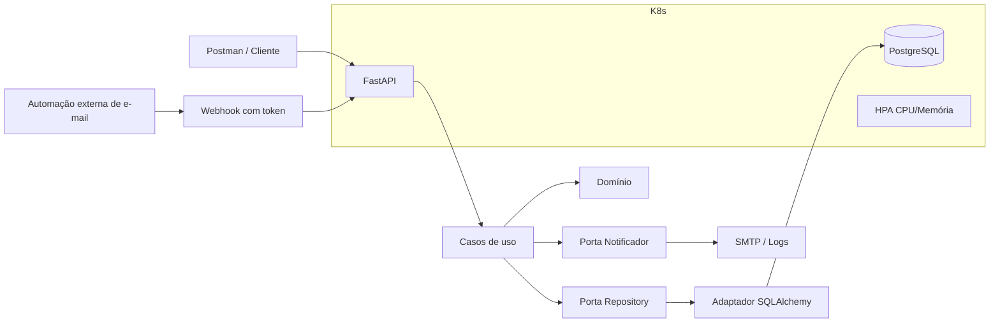

# Arquitetura da solução

## Decisões
- Domínio não importa framework, banco ou transporte.
- Application orquestra regras de caso de uso por interfaces.
- Infrastructure implementa persistência e notificação.
- Presentation contém schemas HTTP e roteamento.
- PostgreSQL é persistente; API é stateless e pode escalar horizontalmente.
- HPA utiliza métricas de CPU e memória; requests/limits são definidos no Deployment.
